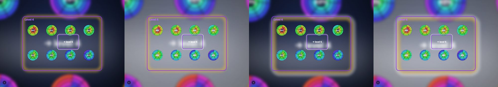
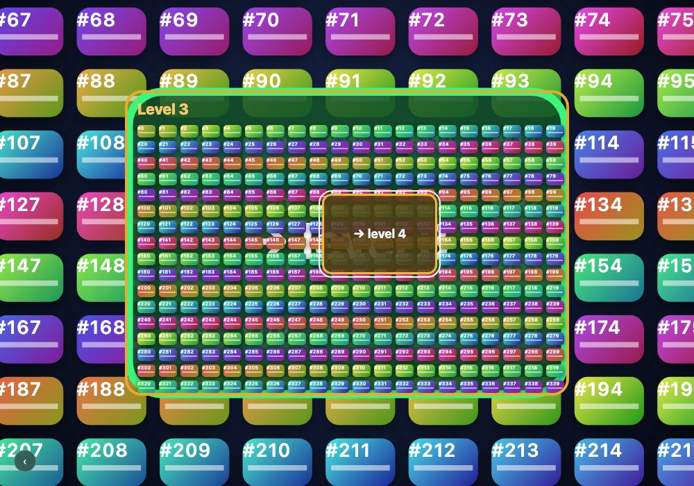

# SnapDOM como compositor de vistas de fondo en Zumly — estudio

Rama `claude/snapdom-compositor-study` (desde `main`, v0.97.0). Experimental, no para mergear.
Fecha: 2026-10-25. SnapDOM 3.4.0 (`dist/`), plugin stream de `@zumer/snapdom-plugins` 4.3.0 (src),
Orbit `dist/` local. Chromium de Playwright, ventana real (GPU Apple M5 vía ANGLE/Metal), 1000×700, dpr 1.

## TL;DR

- **Aplanar las vistas de fondo (flatten) sí sirve, y mucho, cuando las vistas son pesadas.**
  Con GPU real, el frame medio durante la transición baja de **30 a 18 ms** (cards, ~3000 nodos)
  y de **36 a 18 ms** (backdrop-filter), y los frames de más de 34 ms bajan de ~5 a ~1 por
  transición. Con vistas livianas (Orbit, 800 nodos) no cambia nada: ya va a 60 fps.
- **El costo es fijo y está fuera de la transición:** 110–190 ms de captura por vista (con CPU 4×:
  0.65–1.1 s), +30–60 MB de heap JS y 2–5 MB de canvas.
- **Stream es lo que hace viable mantener el bitmap al día**, pero solo para cambios en cajas
  opacas: un reloj vivo cuesta ~13 ms por parche (13% del hilo principal a 10 Hz). Una animación
  CSS sobre algo transparente (un anillo de Orbit girando) lo degrada a un frame completo por tic:
  50% del hilo principal y frames de 150 ms *en reposo*. Sin stream (re-captura completa con
  `MutationObserver`) es inusable con cualquier contenido vivo.
- **Compositar los ancestros profundos (depth) no vale la pena.** No mejora el rendimiento, y con
  4× por nivel el ancestro k se ve ampliado 4^k: de nivel 3 hacia atrás solo aporta un velo de
  color. Es mucha complejidad (matrices, pila, zoom-out) para muy poco efecto.
- **Lo de que "el efecto se pierde" tiene además una causa en Zumly, sin relación con SnapDOM:**
  después de un zoom-out, la vista previa pierde el `filter` de `transitions.effects`
  (`applyZoomOutLastState` borra `has-effect` justo después de que el motor lo asigna).
- **Recomendación: ajustar.** Seguir solo con flatten, como plugin opcional para vistas pesadas,
  con stream y apagado automático cuando hay animaciones. Descartar depth. Arreglar en el core el
  bug de los efectos en zoom-out, aparte.

## Qué se probó

`compositor.js` es un plugin (`app.use(compositor, opts)`) que envuelve el driver de transición
de la instancia, así que funciona con cualquier driver (`css`, `waapi`, GSAP…). Tiene dos piezas
que se miden por separado:

- **flatten**: la vista actual se mantiene capturada en un `<canvas>` mientras el usuario está
  en ella (`stream()` del plugin, o captura única + `MutationObserver` con `source: 'snapshot'`).
  Al hacer zoom-in, la vista que pasa a *previous* (y la *last*) muestran ese bitmap como hijo
  (`.z-flat-layer`) y sus hijos reales quedan `visibility: hidden`. El elemento `.z-view` sigue
  en el DOM y con layout, así que la geometría de Zumly, el hit-test de hermanos y los drivers
  no cambian. El `filter` de `transitions.effects` sigue aplicándose por CSS sobre el bitmap.
- **depth**: cuando una vista deja de ser *last* (Zumly la desengancha del DOM), se dibuja en
  un único canvas del tamaño del lienzo (`.z-backdrop`) junto con el backdrop anterior. Ese
  canvas va detrás de todas las vistas y se anima rígidamente con la vista *last*
  (delta de matrices `M_last_fin · M_last_inicio⁻¹`). Una pila de backdrops permite volver
  con zoom-out. Un solo layer representa a todos los ancestros, sin límite de profundidad.

Escenas (`scenes.js`), 6 niveles, vistas de 640×440, trigger de 160×110 (escala 4× por nivel),
`effects: ['blur(3px)', 'blur(8px) saturate(0)']`, 700 ms, driver `css`:

- **cards**: ~340 tarjetas con gradiente, sombra, radio y texto por vista (~3000 nodos en DOM).
- **blur**: 160 tarjetas + 24 paneles con `backdrop-filter: blur(6px)` y `filter: drop-shadow`.
- **orbit**: 8 gauges Orbit por vista, 4 anillos × 6 `o-arc` (192 `o-arc` por vista, shadow DOM).

Cada corrida: 5 zoom-in + 5 zoom-out, 1.2 s de reposo entre transiciones. Frame time por
`requestAnimationFrame` durante la transición; long tasks por `PerformanceObserver`; heap por
`performance.memory`.

## Resultados

### Transiciones, GPU real (2 corridas, 20 transiciones por fila)

`flat` = vistas de fondo como bitmap; `depth` = backdrop compositado; `both` = las dos cosas.
"Peor frame (mediana)" es la mediana, entre transiciones, del peor frame de cada una.

| escena | modo | frame medio ms | frames >34 ms / transición | peor frame (mediana) | peor frame (máx) | captura ms (mediana) | heap JS MB | canvas MB |
|---|---|---|---|---|---|---|---|---|
| cards | baseline | 30.3 | 4.5 | 150 | 301 | – | 5 | 0 |
| cards | flat | **17.7** | **1.3** | 51 | 167 | 116 | 48 | 2.2 |
| cards | depth | 30.4 | 4.2 | 151 | 250 | 147 | 54 | 2.7 |
| cards | both | **17.7** | **1.1** | 67 | **83** | 108 | 54 | 4.9 |
| blur | baseline | 35.5 | 5.2 | 167 | 300 | – | 4 | 0 |
| blur | flat | **18.1** | **1.1** | 67 | 283 | 174 | 38 | 2.2 |
| blur | depth | 35.0 | 5.2 | 150 | 300 | 189 | 39 | 2.7 |
| blur | both | **17.8** | **1.0** | 67 | 117 | 189 | 39 | 4.9 |
| orbit | baseline | 17.0 | 0.7 | 50 | 67 | – | 4 | 0 |
| orbit | flat | 16.9 | 0.5 | 34 | 68 | 173 | 37 | 2.2 |
| orbit | depth | 17.0 | 0.7 | 50 | 84 | 194 | 33 | 2.7 |
| orbit | both | 17.0 | 0.7 | 50 | 83 | 193 | 33 | 4.9 |

Entre corridas hay ruido (cards baseline dio 34 y 26 ms de media), pero el orden es estable.

### Sin `effects` (¿cuánto del costo es el blur de fondo?)

| escena | baseline | flat |
|---|---|---|
| cards | 19.5 ms, 1.8 frames >34 / transición | 17.5 ms, 1.0 |
| blur | 27.0 ms, 2.8 | 17.6 ms, 0.8 |
| orbit | 17.1 ms, 0.5 | 16.9 ms, 0.6 |

Cerca de la mitad del jank de cards viene del `filter` animado sobre capas grandes con DOM
complejo; el resto es rasterizar el DOM al promover y re-escalar las capas. Aplanar resuelve las
dos cosas, porque el filtro pasa a aplicarse sobre una sola textura.

### CPU 4× (equipo de gama media)

| escena | baseline | flat | both | captura (mediana) |
|---|---|---|---|---|
| cards | 42.2 ms, 4.5 frames >34 | 24.0 ms, 1.8 | 23.6 ms, 1.5 | 660 ms |
| blur | 43.3 ms, 5.2 | 25.7 ms, 1.9 | 29.2 ms, 3.6 | 950–1100 ms |
| orbit | 20.4 ms, 1.1 | 20.5 ms, 1.1 | 21.1 ms, 1.1 | 650 ms |

La media sigue mejorando mucho, pero la captura llega a ~1 s. Si el usuario vuelve a navegar
mientras corre, choca con la transición: el peor frame de blur/flat fue de 1283 ms.

### En reposo con contenido vivo (`live=1`: reloj a 10 Hz; `animated=1`: un anillo de Orbit girando), 5 × 2 s

| escena | modo | hilo principal ocupado | frames de stream | peor frame |
|---|---|---|---|---|
| cards | baseline | 0 ms de long tasks | – | 17.9 |
| cards | flat + stream | 1.3 s en 10 s (13%), 0 long tasks | 101 parches, 0 completos | 17.7 |
| cards | flat + snapshot | 5.8 s de long tasks | 102 re-capturas completas | 83 |
| orbit | baseline | 0 | – | 17.7 |
| orbit | flat + stream | 10 s en 10 s, 4.9 s de long tasks | 56 completos, 0 parches | **151** |
| orbit | flat + snapshot | 5.2 s de long tasks | 54 re-capturas | 167 |

Motivo de los frames completos en Orbit (`reasons.mjs`): `no host for <div.orbit-5>`. El anillo
que gira es transparente y no hay caja opaca debajo que se pueda repintar sola. Sin la animación,
la misma vista de Orbit con el reloj da 40 parches y 0 frames completos.

### Visual



De izquierda a derecha: baseline, depth, flat, both, en el nivel 4 con triggers transparentes.
El velo gris de `depth` son los ancestros 3, 4 y 5 ampliados 64×, 256× y 1024×: solo se ve un
borrón del entorno de su trigger. El halo claro alrededor de la vista actual en `flat` es el
anillo de foco del trigger, congelado en el bitmap (ver más abajo).

## Lo que anda

- Plugin no invasivo: envuelve el driver, no toca `src/`, funciona con el driver `css` y con
  `effects`. La geometría de Zumly no cambia porque los `.z-view` siguen con layout.
- Fidelidad de SnapDOM: buena en las tres escenas (gradientes, sombras, `backdrop-filter`,
  `o-arc` en shadow DOM). Una vista de Orbit capturada es indistinguible de la viva a escala 1.
- El stream con `outerTransforms: false` sobre la vista actual (escala 1) mantiene el bitmap
  al día con parches de ~13 ms cuando lo que cambia tiene fondo opaco.
- Capturas fuera de la transición: en idle, después de llegar a la vista. Si la navegación
  llega antes de que estén listas, se usa el DOM vivo (fallback limpio, sin bloquear).
- depth funciona mecánicamente con 6 niveles: se muestra al entrar, se anima rígido con la vista
  *last*, y la pila se deshace en el zoom-out.

## Lo que no anda / se pierde

- **Contenido vivo y animado en el fondo:** queda congelado en el último frame. Mientras la
  vista es la actual, el stream lo sigue, pero las animaciones CSS sobre elementos transparentes
  (típico de Orbit) lo degradan a frames completos. Habría que detectar eso (tasa de frames
  completos) y apagar el stream, y capturar una sola vez al salir.
- **Estado de interacción congelado:** el bitmap guarda el estado del momento de la captura. Por
  ejemplo, Zumly enfoca el primer focusable de la vista nueva (`_manageFocus`): el anillo de
  foco del trigger queda en la captura y, ampliado 4×, se ve como un halo alrededor de la vista
  actual. Lo mismo pasa con `.zoomed` y `hideTrigger`. Probé dos arreglos y los descarté:
  recortar el trigger del bitmap (borra el label y el borde que Zumly sí muestra) y re-capturar
  la vista previa ya asentada (salió desplazada ~4 px locales y perdió los `o-arc`, ver hallazgos).
- **Nitidez al escalar:** el bitmap está a escala 1 × dpr y la vista previa se ve a 4× (la *last*
  a 16×). Con `effects` encendido no se nota; sin blur, el texto del fondo se ve borroso.
  `scale: 2` lo mejora a costa de 4× de memoria.
- **Interactividad del fondo:** no se pierde. Los hijos están `visibility: hidden` pero con
  layout, y el hit-test de hermanos de Zumly usa `getBoundingClientRect`.
- **Accesibilidad:** los hijos con `visibility: hidden` salen del árbol de accesibilidad. Zumly ya
  marca el fondo como inerte, así que en la práctica no cambia, pero un lector de pantalla que
  navegara el fondo no lo encontraría.
- **Memoria:** +30–60 MB de heap JS (cachés de SnapDOM) contra 3–5 MB de baseline, más
  2–5 MB de canvas. Antes del arreglo, capturar una vista *last* ya escalada pedía un bitmap
  16× (unos 10000 × 7000 px).

## Hallazgos colaterales (independientes de SnapDOM)

1. **Zumly: los `effects` se pierden después de un zoom-out.** `_performZoomOut` le asigna
   `effects[0]` a la vista que pasa a *previous*, pero el driver termina con
   `applyZoomOutLastState` (`src/drivers/driver-helpers.js`), que borra `has-effect` y
   `--z-effect-filter`. La vista que se re-engancha (`detachedNode`) tampoco recupera
   `effects[1]`. Resultado: al volver, el fondo queda nítido hasta el próximo zoom-in
   (). Probablemente sea lo que se nota como
   que "el efecto se pierde después de dos pasadas". Es un arreglo chico en el core, sin SnapDOM.
2. **SnapDOM: `outerTransforms: false` conserva la escala de la raíz** (lo documenta: quita
   translate y rotate). Capturar una vista de fondo escalada da un bitmap escalado; hay que
   compensar con `scale: 1/s`. Conviene documentarlo bien visible para este caso de uso.
3. **SnapDOM hornea el `filter` de la raíz** y agranda el bbox por el sangrado del blur
   (`contentX/Y`). Es correcto, pero quien compone tiene que saberlo para no aplicar el filtro
   dos veces.
4. **SnapDOM (observado, no aislado):** al re-capturar una vista escalada, con hijos ocultos por
   `visibility` y `excludeStyleProps: /^visibility$/`, la imagen salió desplazada ~4 px locales
   y sin los `o-arc` (shadow DOM). Un repro mínimo de raíz escalada con `transform-origin`
   distinto de 0 **no** reprodujo el desplazamiento, así que la causa está en otra parte
   (`contain: strict`, `content-visibility`, el borde o el shadow DOM). Queda para aislar.
5. **Stream y raíces transformadas:** `hostFor` y `rectOf` miden con `getBoundingClientRect`
   relativo a la raíz, y `hasEffect` no mira la raíz. Con una raíz escalada, los parches
   quedarían en coordenadas escaladas. No lo medí porque el prototipo solo usa stream con la
   vista a escala 1; vale un test en SnapDOM.

## Recomendación

**Ajustar.** Concretamente:

1. **Descartar depth.** No mejora el rendimiento y el beneficio visual se reduce a un velo de
   color, porque cada ancestro se ve ampliado 4^k. Si se quiere más "túnel", es más barato
   bajar la escala por nivel (triggers más grandes) que compositar.
2. **Seguir con flatten como plugin opcional** (`zumly/compositor` o un paquete aparte con
   SnapDOM como peer dependency), recomendado solo para vistas pesadas: más de ~1000 nodos,
   `backdrop-filter`, sombras. No meterlo en el core: Zumly no debe depender de SnapDOM.
3. **Antes de eso, dos experimentos baratos sin SnapDOM**, porque la tabla sin `effects` muestra
   que la mitad del jank es el `filter` animado: (a) no animar el `filter` durante la transición
   (aplicarlo al final, o hacer un crossfade de opacidad); (b) `content-visibility: hidden`
   sobre la vista *last* durante la transición. Si con eso cards baja a ~20 ms, flatten pasa a
   ser un nicho.
4. **Arreglar el bug de effects en zoom-out** en el core, por separado.

### API propuesta (si se sigue)

```js
import { snapdom } from '@zumer/snapdom'
import { stream } from '@zumer/snapdom-plugins/stream'
import { compositor } from 'zumly/compositor'

app.use(compositor, {
  snapdom, stream,          // inyectados: Zumly no depende de SnapDOM
  scale: 1,                 // resolución del bitmap (× dpr)
  minNodes: 800,            // por debajo de esto, no aplanar (no gana nada)
  maxFullFramesPerSec: 1,   // si el stream degrada a frames completos, apagarlo y capturar al salir
})
```

Por vista: `data-z-live` para no aplanar nunca una vista (video, canvas, animación que tiene que
seguir viva en el fondo).

Lo que haría falta en el core para no tocar internos (hoy el plugin reemplaza
`app.transitionDriver` y lee `app.storedViews`):

- un middleware de driver: `app.wrapDriver((spec, next) => ...)`;
- eventos `viewDetached` y `viewReattached` (hoy el `detachedNode` solo se ve en el snapshot);
- `beforeTransition` y `afterTransition` con `spec`, para preparar y liberar capas.

## Cómo reproducir

```bash
node experiments/snapdom-compositor/bench.mjs --headed --out /tmp/r.json
node experiments/snapdom-compositor/bench.mjs --headed --cpu 4 --only baseline,flat
node experiments/snapdom-compositor/bench.mjs --headed --only orbit:flat --q '&live=1&animated=1' --rest 2000
node experiments/snapdom-compositor/shots.mjs /tmp/shots orbit baseline,depth,flat,both '&outline=1'
node experiments/snapdom-compositor/summarize.mjs /tmp/r.json
```

La página `bench.html` también se abre a mano: `?scene=cards|blur|orbit&mode=baseline|flat|depth|both`
`&source=stream|snapshot&live=1&animated=1&effects=0&outline=1`. Requiere que `snapdom/` y `orbit/`
estén como repos hermanos de `zumly/` (el servidor de `bench.mjs` los sirve en `/snapdom/` y `/orbit/`).
